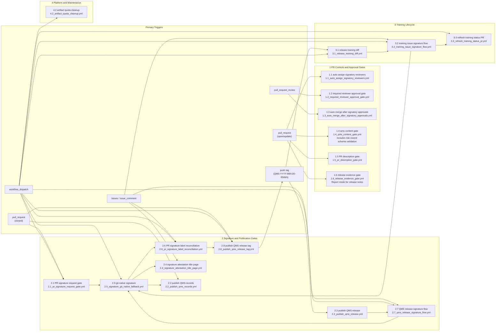

# Pharma-QMS System Architecture

## 1. TL;DR
- GitHub is the canonical controlled surface for both content and workflow execution.
- this repository (`Zeuthens/Pharma-QMS`) governs the Zeuthen QMS; product execution records (for example for `Zeuthens/impd-automation`) may live in designated repositories that reuse the same templates and signature model.
- PR review on a specific head SHA is the approval boundary before merge.
- Post-merge attestation is the formal electronic signature manifestation step.
- Immutable GitHub Releases are the long-term evidence package for records and QMS releases.
- No hosted signature service is used: post-merge PR, training-issue, and QMS-release signatures are all captured with the git-native workflow `2.5` (GitHub `workflow_dispatch` + GitHub App attestation comment).

## 2. What This Document Covers
This document describes how the QMS operates as a system: where controlled content lives, which GitHub Actions enforce policy, how signatures and publication work, and where the external trust boundaries are. Process rules remain in the SOPs and WIs; this document explains the platform behavior around them.

## 3. Architecture Overview
Pharma-QMS is a GitHub-native QMS operating model built from:
- controlled content in `qm/`, `sops/`, `matrices/`, selected company-level records, reusable templates, and `.github/`
- GitHub Issues for planning and coordination
- GitHub Pull Requests for controlled review and approval
- GitHub Actions for policy evaluation, signing orchestration, training automation, and immutable publication
- GitHub Releases for immutable record and QMS release packaging
- the git-native signature workflow `2.5_signature_git_native_fallback.yml` for the post-merge PR, training-issue, and QMS-release signature ceremonies (no externally hosted signature service is deployed)

The canonical controlled reading surface remains GitHub at the approved commit or tag. QMS releases are formalized by tags matching `QMS-YYYY-MM-DD-RNNN`.

This repository was adopted from an external open baseline release recorded in [`adoption/upstream-baseline.json`](../../adoption/upstream-baseline.json) (attribution in [`NOTICE`](../../NOTICE)). Zeuthen owns all content from adoption onward; any later upstream changes are taken in only through a controlled change under `SOP-009`. Local adoption-readiness settings live in [`adoption/readiness-config.json`](../../adoption/readiness-config.json).

## 4. Core Components
| Component | Role in the architecture |
|---|---|
| GitHub repository (`Zeuthens/Pharma-QMS`) | System of record for QMS procedures, matrices, workflow definitions, reusable templates, and selected company-level records. |
| `adoption/` + `tools/` | Records the adopted baseline ref and the repository settings and placeholder checks used by `tools/check_adoption_readiness.sh`. |
| GitHub Issues | Planning and intake layer for CAPA, audit, risk, training, V&V, release, complaint, PMS, and change activities. |
| GitHub Pull Requests | Controlled review, approval, and merge boundary for QMS document and record changes. |
| GitHub Actions | Policy evaluation, reviewer assignment, signature orchestration, training automation, publication, and maintenance jobs. |
| GitHub Releases | Immutable publication surface for quality records and formal QMS release packages. |
| Git-native signature workflow (`2.5`) | Signer-triggered `workflow_dispatch` that verifies signer eligibility (PR approvals for merged PRs; the training matrix for training issues; the signer registry and release decision PR for QMS releases) and posts the signature attestation through the GitHub App. |
| GitHub App token | Required for signature-attestation comments, PR automation, and merges, including PRs that modify workflow files. This GitHub App belongs to the `Zeuthens` GitHub account and is installed only on the Zeuthen repositories that need it. |
| Signer registry (`matrices/signer_registry.json`) | Source for resolved signatory legal names and job titles in attestation output (trainees not in the registry use their `matrices/training_matrix.yml` entry). |

## 5. Primary Data Flows
1. A QMS activity starts from an issue, a release tag, or a manual workflow dispatch.
2. Controlled changes are implemented on a branch and proposed through a pull request.
3. Gate workflows evaluate approval and structural rules on the PR and can drive auto-merge behavior where repository settings allow enforcement.
4. Once merged, post-merge workflows request signatures, maintain PR signature-status labels, collect attestations, and publish immutable record evidence for execution records maintained in the target repository.
5. Release-plan attributed PRs that carry approved QMS release notes and complete PR signatures publish the formal `QMS-*` tag at the merge commit.
6. Training automations derive additional work items from released or merged state.
7. Formal QMS releases package the approved repository state as a GitHub Release on the QMS tag.

Adoption-specific flow for this repository:

8. Company-owned matrices and operational records are tailored and validated under `SOP-006` before first operational use.
9. Any later change to the adopted baseline is made through a controlled change under `SOP-009`; `adoption/upstream-baseline.json` is updated when a newer external baseline release is adopted.

## 6. Automation Map
The current workflow topology is summarized below.

## 7. Automation Catalog

### 7.1 PR Controls and Approval Gates
| Workflow | Primary trigger | Purpose | Status |
|---|---|---|---|
| `1.1_auto_assign_signatory_reviewers.yml` | `pull_request` | Resolves required signatory reviewers from requested signature roles and assigns them. | Active |
| `1.2_required_reviewer_approval_gate.yml` | `pull_request_review` | Publishes the required `qms_approval_gate` commit status after validating that required non-author approvals exist on the current head SHA. | Active |
| `1.3_auto_merge_after_signatory_approvals.yml` | `pull_request_review` | Enables auto-merge after assigned reviewer approvals are present; repository-level branch protection or rulesets are still required to hard-block manual merges. | Active |
| `1.4_qms_content_gate.yml` | `pull_request` | Validates revision-history, README navigation/index, training-matrix synchronization, ISO 9001 matrix publication/mapping, configured record-index sanity checks, and risk-record schema validation for controlled content changes. | Active |
| `1.5_pr_description_gate.yml` | `pull_request` | Validates that the PR body contains structural headers for `Summary`, `Why` (or `Context`), and `Validation` (or `Testing`). | Active |
| `1.6_release_evidence_gate.yml` | `pull_request` on release notes | Reports controlled-document signature coverage and traceability coverage for QMS release-note PRs; report mode does not block merges while historical evidence coverage is being baselined. | Report mode |

### 7.2 Signature and Publication Gates
| Workflow | Primary trigger | Purpose | Status |
|---|---|---|---|
| `2.1_pr_signature_request_gate.yml` | `pull_request` (closed, merged) | Parses PR signature requirements and posts or refreshes signer-specific signature requests. With no `SIGNATURE_UI_BASE_URL` configured (the Pharma-QMS default), the request points signers to workflow `2.5`. | Active |
| `2.6_pr_signature_label_reconciliation.yml` | `issue_comment`, `workflow_dispatch` | Reconciles `signature/outstanding` / `signature/complete` on merged PRs based on the latest signature request comment and collected attestations. It also removes legacy plural label variants from PRs. | Active |
| `2.2_publish_qms_records.yml` | `pull_request` (closed, merged) | Waits for signatures, packages changed execution record artifacts under `records/`, groups risk/usability bundles where required, and publishes immutable releases. Files under `records/releases/` are excluded because they belong to the QMS baseline release flow, not the execution-record publication flow. | Active |
| `2.3_publish_qms_release.yml` | `push` on QMS release tag | Packages the approved repository state, publishes the formal QMS release bundle, and closes the linked release-plan issue after successful publication. It then dispatches `2.7` to request the release package signature (see section 11). It is serialized per release tag and treats an existing immutable release with both expected assets as already published. | Active |
| `2.4_signature_attestation_title_page.yml` | `issue_comment` | Supports signature-certificate generation for attestation packages. | Active support workflow |
| `2.5_signature_git_native_fallback.yml` | `workflow_dispatch` | Git-native signature path for merged PRs, training issues, and QMS release planning issues: the signer runs the workflow with the PR or issue number and full legal name; the workflow verifies eligibility and the target hash and posts the attestation. | Active (only signature path) |
| `2.7_qms_release_signature_flow.yml` | `release`, `workflow_dispatch` (from `2.3`), `issue_comment` | Posts release-signature requests (signed with `2.5`) on the release-plan issue, binds signatures to the published immutable `QMS-*` release package, publishes the release attestation assets as a separate immutable `sig-qms-release-*` evidence release, and closes the release-plan issue after completion. Non-`QMS-*` GitHub Release events are ignored for request creation. | Active |
| `2.8_publish_qms_release_tag.yml` | `pull_request` (closed/labeled on QMS release notes), `workflow_dispatch` | Creates the formal `QMS-*` release tag at the merge commit only for merged PRs with `signature/complete`, an approved QMS release-notes record, a matching release-plan issue pointer, and a release-change attribution to that PR. | Active |

### 7.3 Training Lifecycle
| Workflow | Primary trigger | Purpose | Status |
|---|---|---|---|
| `3.1_release_training_diff.yml` | `push` on QMS release tag, `workflow_dispatch` | Compares required controlled-document revisions to the current training status register and opens one consolidated training issue per user. It is serialized per release tag / manual dispatch scope so duplicate tag deliveries cannot race each other into duplicate training issues. | Active |
| `3.2_training_issue_signature_flow.yml` | `issues`, `issue_comment`, `workflow_dispatch` | Requests the trainee's signature (signed with `2.5`) once the training checklist is complete, then reconciles the attestation comment and closes the issue automatically. After successful reconciliation it calls `3.3` to refresh the generated training status register. | Active |
| `3.3_refresh_training_status_pr.yml` | `workflow_dispatch`, `workflow_call` | Exports training issue evidence, rebuilds the generated training status artifacts, opens or updates a PR when those generated files change, and maintains a visible failure notice for manual retry. This is the single workflow that owns the refresh PR. | Active |

### 7.4 Platform and Maintenance Operations
| Workflow | Primary trigger | Purpose | Status |
|---|---|---|---|
| `4.2_artifact_quota_cleanup.yml` | `workflow_dispatch` | Deletes old workflow artifacts to control storage quota. | Active maintenance |

## 8. External Dependencies and Trust Boundaries
| Dependency | Boundary | Purpose |
|---|---|---|
| GitHub-hosted Actions runner | External platform runtime | Execute automation logic, evaluate configured gates, and publish releases. |
| GitHub App credentials | Zeuthen-owned secret-managed integration | Authenticates PR-comment posting, signature requests, attestations, and repository automation. Zeuthen creates and installs the GitHub App on the Zeuthen repositories that need QMS automation. |
| Repository secrets and variables | Controlled configuration | Provide signing and deployment configuration. |

Signature-status labels are part of the operating model for merged PRs and signed issues:

- `signature/outstanding` means the merged PR has an active signature request and is still awaiting the required attestations.
- `signature/complete` means the latest active signature request has enough valid attestations for that PR or issue / hash / meaning combination.

## 9. Tag Namespaces

High-volume immutable publication tags and downstream-adoptable baseline tags must remain separate.

- `QMS-*` is the formal Pharma-QMS release namespace.
- `QMSPREVIEW-*` is reserved for immutable candidate baselines when a stable preview is needed.
- record/signature tags such as `sig-*`, `record-*`, and `trn-*` are evidence-retention tags.

For formal `QMS-YYYY-MM-DD-RNNN` tags, the date component is the publication date recorded for the
approved Pharma-QMS release, and `RNNN` is the sequential Pharma-QMS release number.

This separation keeps immutable publication tags apart from formal QMS release tags.

## 10. Platform Caveat
On private repositories using GitHub Free, GitHub does not provide branch protection or rulesets to hard-block merges. In that deployment model, Pharma-QMS workflows can validate approvals and avoid enabling auto-merge, but an accidental manual merge without the intended approvals remains technically possible.

## 11. Training and QMS-Release Signatures

By decision of the QMS owner (2026-10-17), training-issue (`3.2`) and QMS-release package (`2.7`) signatures use the same git-native workflow `2.5` as merged-PR signatures; no hosted signing endpoint is used and `SIGNATURE_UI_BASE_URL` is not required (`2.1` still reads it as an optional variable; leave it unset).

- `3.2` posts a bot signature request on the training issue once its controlled-document checklist is complete (meaning `Completed QMS Training Review`, role `Trained Personnel`, target hash over the issue content). The trainee runs `2.5` with the issue number and full legal name. `2.5` accepts only the assigned trainee named in the issue marker, checks that the trainee is assigned in `matrices/training_matrix.yml` to every role in scope, and recomputes the issue-content hash.
- `2.3` dispatches `2.7` after publishing a `QMS-*` release; `2.7` (also triggered by `release: published`) posts a bot signature request on the release planning issue (meaning `Approved Published QMS Release`, signer slots and required count from the signed release decision PR, target hash over the published release package). Each signer runs `2.5` with the issue number. `2.5` requires an entry in `matrices/signer_registry.json`, re-downloads the release assets and recomputes the package hash, and checks that the signer and role match the release decision PR's bot-posted `2.1` request.
- `2.5` runs only when dispatched from the default branch, reads `matrices/` from the default branch, signs the attestation manifest (printed name, signer title and role, UTC date/time, meaning, target hash) with Sigstore keyless signing, and posts the manifest, signature and certificate as a QMS GitHub App comment. The run name carries the record number.
- `3.2` / `2.7` accept only requests and attestations posted by the QMS GitHub App (`zeuthen-pharma-qms-bot[bot]`; `github-actions[bot]` is not trusted) whose signer, hash and meaning match the latest request. For each attestation they verify through the Actions API that the named run is a successful `workflow_dispatch` run of `2.5` on the default branch, started by the signer, for this record, and verify the Sigstore signature with `cosign verify-blob` against the certificate identity of `2.5` on the default branch. `3.2` also refuses to close a training issue whose content changed after the signed request. The verified manifest, `.sig` and `.pem` are attached to the immutable `sig-train-*` / `sig-qms-release-*` evidence release.

Record of truth: issue and PR comments remain editable by users with write access, so the attestation comment is a working copy. The hash-bound evidence release (signed manifest, Sigstore signature and certificate, aggregate attestation, and for releases the signature certificate PDF) is the retained signature record.

Authentication rationale: a signature is executed by the signer's own authenticated GitHub session (which must have two-factor authentication enforced) dispatching `2.5`, together with the signer's typed full legal name, which must match the signer registry or training matrix. There is no separate signing PIN. Each `2.5` run is a distinct signing event with its own authentication.

Owner actions and validation: move `QMS_BOT_APP_ID` / `QMS_BOT_APP_PRIVATE_KEY` to a GitHub environment restricted to the default branch (a repository setting; the `if:` guard in `2.5` is only a safeguard against stale refs, since a branch can edit the workflow file), and enforce 2FA on all signer accounts. Before the first training cycle and the first formal `QMS-*` release, the `SOP-006` validation must confirm the issue signature paths, the run and Sigstore verification, and that this authentication rationale (GitHub session + enforced 2FA + typed full legal name) is adequate for the intended electronic-signature use.
